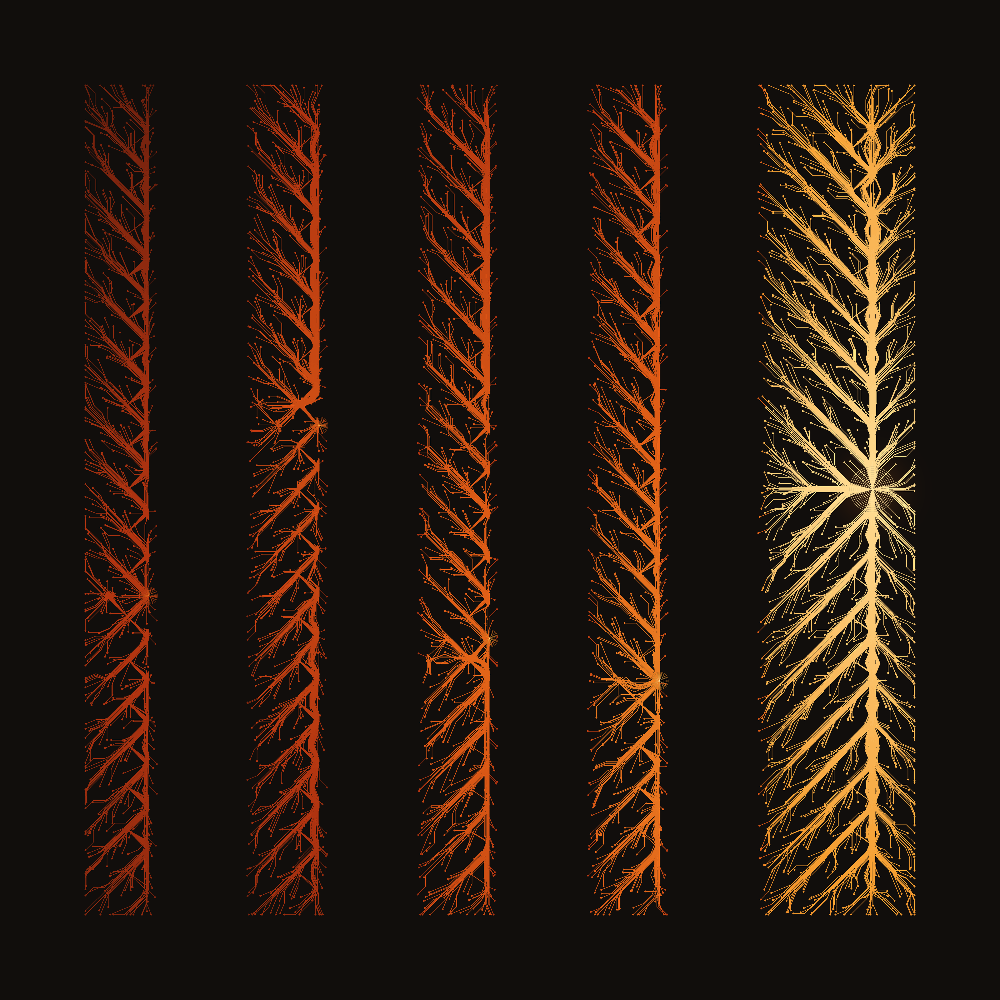

# ThermoNav

**A complete drone navigation brain, formulated to run on a thermodynamic computer — and measured, end to end, in simulation.**

ThermoNav writes navigation onto an Ising substrate of the class Extropic is building: the map becomes fields and couplings, a sampler grows the route out of the goal, a 123-parameter stochastic kernel flies the vehicle downhill, and a safety stack — freshness gates, an escalation ladder, battery and link and estimator-health monitors — watches every step. It is, as far as we know, the only functional proof of concept of a full navigation stack for this hardware that you can download, read, and run.



*The wavefront planner's field in one floor of a 3D maze — descent paths traced through the measured field that ships in `wavefront/data/`. Provenance: `assets/PROVENANCE.md`.*

## Status, stated plainly

- **Simulation only.** Everything was built and measured in THRML, Extropic's JAX-based simulator for its probabilistic hardware, on desktop CPUs. Nothing has run on Z1 silicon; this is not a validated aircraft.
- **We did not build the chip.** This is cartography of its landscape: which navigation behaviors the substrate supports, which it cannot, and where it breaks — measured, with the breaks published in this repository at the same standard as the wins.
- **Not for sale, and not a pitch.** It's a working proof of concept, offered so other people can use it, check it, or try to break it.

## What's in the box

| Directory | What it is |
|---|---|
| `wavefront/` | The substrate planner: THRML wavefront experiments (2D + three 3D ceilinged mazes), the maze generator, the saved fields, and the analysis that recomputes every headline number from those fields |
| `s2_theta/` | The flight controller: the 123-parameter Ising kernel (v3 default, v2 fallback), training scripts and data, evaluation and generalization benchmarks |
| `thermopilot/` | The navigation harness: teacher agent, A* reference planner, D5 safety veto, Ising/sampler helpers |
| `sim/` | The dynamics validation suite and the safety machinery: escalation ladder, battery layer, link health, nav health, dynamic-object layer, below-clear hold — each with its model doc, tests, and validation record |
| `redteam/` + `REDTEAM.md` | The red-team record: shipped lines, killed lines, measured envelopes — the negatives published with the wins |
| `rooms/` | 30 HM3D indoor occupancy grids used for training and benchmarking |
| `docs/` | `ARCHITECTURE.md` (how the brain fits together), `RESULTS.md` (the measured-results digest), `OPEN_PROBLEMS.md` (what doesn't work yet — a first-class section, not a footnote) |
| `assets/` | Figures rendered from the lab's saved fields, with provenance |

## Known successes (measured, red-teamed)

- **The kernel flies.** 24/24 success, 0 collisions in 12 indoor rooms it never saw in training; bit-identical outcomes to its engineered teacher across 16 paired clear-air flights. 123 parameters, 492 bytes, legal on the substrate's rails by construction (degree ≤ 15, |h| ≤ 5.35, |J| ≤ 1.14 against rails of 16 / 6 / 6).
- **The planner's field is the sampler's.** Across three 3D mazes the wavefront field matches true distance at correlation 0.98–0.994; on the 2D headline the raw field — no host smoothing — is 0.9982 of the published 0.9991. Switch the coupling off and the field is noise and routing dies: the dynamics are the computation, and the ablation proves it.
- **The safety stack is the deepest-tested part.** D5 freshness gate (collision cells → 0 in fog/whiteout + jitter, zero false fires in clear air); escalation decider verified 128/128 against its policy oracle; battery cascade validated over 9 missions, 6/6 gates, 0 collisions; dynamic-object layer took the paired mover sweep from 43/48 collisions to 7/48.
- **The record survives scrutiny.** Every shipped line passed pre-registered bars and at least one red-team round that re-derived its numbers from raw artifacts; several passed three to five rounds. A capstone review of the wider program audited 397 claims across 12 units.
- **Credit where it's due:** the planner field's settled values equal a classical distance transform — we do not claim otherwise. The non-replaceable parts are the stochastic flight controller and the safety/memory machinery, and the fact that map, plan, and flight decisions live in one physical system with one programming model.

Full digest: [`docs/RESULTS.md`](docs/RESULTS.md).

## Known pitfalls and open problems

The short list; the full, first-class version is [`docs/OPEN_PROBLEMS.md`](docs/OPEN_PROBLEMS.md).

- **Self-location is THE open problem.** The stack consumes pose; it doesn't yet produce it well enough. Ground truth is scoring-only in the current program, earlier GT-fed "successes" are revoked and labeled, and the standard front-end fragments in our simulated worlds (the sim VIO gate is not met).
- **Collision counts are flight-phase only** until a ground-phase counting fix lands — read every "0 collisions" with that scope.
- **1×1 vertical shafts are unclimbable** by the current move set. Measured, geometric, hard.
- **Battery draw and wind are unmeasured models.** The safety cascade's logic is validated; its power numbers are calculated, not measured against a real vehicle. The wind estimator is unbuilt in the current stack (a retired prototype's PASS was corrected to a partial on re-test).
- **Field healing is unmeasured.** Maps are static within a mission; how fast the planner's field re-relaxes when the world changes mid-flight is being measured now — no results yet.
- **Diffuse sensing only.** Under a specular-reflection sensor model, long routes fail by map erasure at specular fractions ≥ ~0.1 — red-team verified; the full annotation is in `REDTEAM.md`.

## Quickstart

```python
import numpy as np, sys
sys.path += ['s2_theta', 'thermopilot']
from s2_learned import LearnedS2Agent

agent = LearnedS2Agent()  # loads s2_theta_v3.npz by default
# agent = LearnedS2Agent(param_file='s2_theta/s2_theta_v2.npz')  # v2 fallback
# agent.act(pos, goal, p_occ) -> next waypoint, same interface as the engineered S2
```

Requirements: Python 3.10+, `numpy`, `jax[cpu]`, `optax`, `networkx`, `thrml` (see `requirements.txt`; THRML is Extropic's library, installed per their instructions — it is a dependency, never vendored here). Training used `XLA_PYTHON_CLIENT_PREALLOCATE=false`.

Reproduce the headline numbers:

```bash
cd s2_theta && python bench_generalization.py --agent learned   # 12 novel rooms
cd ../wavefront && python analyze_rerun.py data data/results_rerun.json ./check --commit any
# ^ recomputes the wavefront correlations from the saved fields alone
```

**What an outsider cannot run as-is, said exactly:** the wavefront *sampler* (`wavefront/sim_2n_wave.py`) runs anywhere THRML installs, but its original full runs took minutes per case on a desktop CPU (Ryzen 9 9800X3D under WSL2) — sim wall-clock measures the simulator, never a chip. The physics-tier flight validation (Unreal Engine + AirSim on a Windows PC) is **not** in this repository; the harness pieces here are the CPU simulation suite. EuRoC evaluation used a from-source ORB-SLAM3 build and the public EuRoC dataset, neither vendored here.

## What we tried that didn't work (summary)

Reward-driven retraining of the kernel was tried three ways (coarse reward, 1,000 episodes, dense per-decision shaping): the parameters moved up to 5.5× more, the capability didn't — the kernel sits at its architectural ceiling, and v3 stays shipped. Stochastic action sampling: 0/9 vs deterministic readout 22/22, killed. Two learned evidence-mapping rounds: both died in whiteout closed-loop despite winning on held-out loss. All of it is in `REDTEAM.md`, with numbers.

## How this was built

ThermoNav comes out of an independent, self-taught one-person lab. The method is the product as much as the code: bars registered before runs, paired conditions, red teams that re-derive numbers from raw artifacts, negatives published next to wins, and a correction trail that is preserved rather than edited away. If you find a claim in here you can't reproduce from the shipped artifacts, that is a bug in this repository — open an issue.

## License

Apache-2.0 — see [LICENSE](LICENSE).
